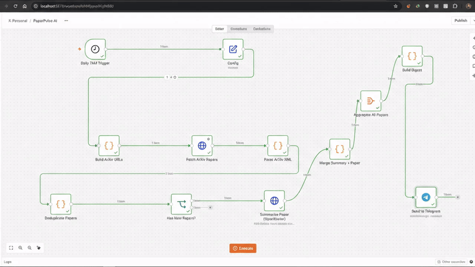

# PaperPulse AI

### A daily research radar for new arXiv papers

Discover papers in your fields, get an evidence-grounded research brief, and receive a clean digest in Telegram — automatically.

  

Looping, silent preview · <a href="paperpulse_ai_vid.mp4">Open or download the original MP4</a>

PaperPulse AI is a self-hosted **n8n workflow** that checks selected arXiv categories every morning, removes papers it has already processed, summarizes new abstracts with an OpenRouter model, and sends researcher-friendly digests through a Telegram bot.

> **Designed for:** researchers and curious readers who want a focused view of new work without manually checking several arXiv feeds.

## At a glance

| | |
| --- | --- |
| **Runtime** | n8n in Docker Compose, pinned to <code>2.44.7</code> |
| **Schedule** | Daily at **7:00 AM**, <code>Asia/Kolkata</code> |
| **Sources** | [arXiv Atom API](https://info.arxiv.org/help/api/user-manual.html) |
| **AI provider** | OpenRouter; Xing4.0 free model by default |
| **Delivery** | Telegram bot |
| **Default watchlist** | <code>cs.AI</code>, <code>cs.LG</code>, <code>cs.CL</code>, <code>stat.ML</code> |
| **Credentials** | Configured in your n8n instance; secret values are absent from the committed template |

## What you get

- **A configurable research watchlist.** Choose arXiv categories and the number of latest submissions to check in each.
- **Useful paper metadata.** Each entry includes the arXiv ID, title, the first three authors (plus a count of the rest), submission date, matched and primary categories, all listed subjects, and DOI or journal reference when arXiv provides them.
- **A concise research brief.** The model returns a contribution, method, evidence, limitations, and 3–5 tags. It is instructed to use only the title and abstract and to mark information that is not stated.
- **A readable Telegram digest.** Titles, labels, metadata, and links are formatted for Telegram. Long digests are split into safe-sized messages.
- **Duplicate filtering.** Version suffixes are removed from arXiv IDs, so a paper found in more than one category is only summarized once.
- **No community nodes required.** The workflow uses n8n built-in nodes.

## How the workflow runs

~~~mermaid
flowchart LR
    A[Daily 7:00 AM trigger] --> B[Read categories and limits]
    B --> C[Build arXiv queries]
    C --> D[Fetch Atom feeds]
    D --> E[Parse papers and citation metadata]
    E --> F[Remove previously seen IDs]
    F --> G{Any new papers?}
    G -- Yes --> H[Summarize each abstract with OpenRouter]
    H --> I[Combine summaries with paper metadata]
    I --> J[Format and split digest]
    J --> K[Send to Telegram]
    G -- No --> L[End without a message]
~~~

### Research brief format

Each paper is delivered with a linked title and the available citation metadata, followed by a compact brief:

> **Contribution:** What the paper claims to add.
>
> **Method:** The approach described in the abstract.
>
> **Evidence:** Datasets, comparisons, and metrics stated in the abstract.
>
> **Limitations:** Limitations stated in the abstract, or “Not stated in abstract.”
>
> **Tags:** Three to five concise research keywords.

The model sees the paper title and an abstract capped at **5,000 characters**. Its response is limited to **450 tokens** and prompted to stay under 150 words. These summaries are a reading aid, not a substitute for checking the paper before citing a claim.

## Quick start

### 1. Requirements

- Docker Desktop (or Docker Engine) with Docker Compose.
- An [OpenRouter API key](https://openrouter.ai/keys).
- A Telegram bot and the chat ID where you want to receive the digest.

### 2. Create the local n8n encryption key

From this repository directory, copy the example environment file and edit <code>.env</code>:

~~~powershell
Copy-Item .env.example .env
notepad .env
~~~

On macOS or Linux, use <code>cp .env.example .env</code> instead of <code>Copy-Item</code>.

Replace the sample <code>N8N_ENCRYPTION_KEY</code> with a unique, random value of at least 32 characters. **Keep this value safe and unchanged**: n8n uses it to encrypt credentials saved in its local database. If the key is lost or changed, the saved credentials cannot be decrypted. See n8n's [deployment configuration docs](https://docs.n8n.io/hosting/configuration/environment-variables/deployment/) for details.

### 3. Start n8n

~~~shell
docker compose up -d
~~~

Open [http://localhost:5678](http://localhost:5678) and create or sign in to your local n8n owner account. The Compose file binds the service to <code>127.0.0.1</code>, so this setup is for use on your own machine.

### 4. Import the workflow

In n8n, choose **Import from File** in the workflow menu and select [<code>workflow.json</code>](workflow.json). The workflow is imported **unpublished**. Its API credentials and Telegram destination are intentionally left for you to configure.

### 5. Add your credentials and destination

1. **OpenRouter:** Create an n8n **HTTP Header Auth** credential with header name <code>Authorization</code> and value <code>Bearer YOUR_OPENROUTER_API_KEY</code>. Select it in **Summarize Paper (OpenRouter)**.
2. **Telegram:** Create a **Telegram API** credential with your bot token. Select it in **Send to Telegram**.
3. In **Send to Telegram**, replace <code>YOUR_TELEGRAM_CHAT_ID</code> with the destination chat ID. To create a bot, message [@BotFather](https://t.me/BotFather); open your bot and send <code>/start</code> before testing a personal chat. Retrieve the ID from the <code>message.chat.id</code> field returned by Telegram's official [getUpdates method](https://core.telegram.org/bots/api#getupdates). Protect the bot token used to call the API.

### 6. Test before publishing

1. In **Config**, temporarily set one topic and <code>max_results</code> to <code>1</code>.
2. Run the workflow manually from the editor.
3. Confirm the summary and paper link arrive in the intended Telegram chat.
4. Restore your preferred watchlist and result count.
5. Select **Publish** in n8n to enable the daily 7:00 AM schedule.

If OpenRouter returns HTTP <code>429</code> during the test, wait before retrying and check the [rate-limit guidance](#rate-limits-and-volume) below.

## Configuration

Edit the **Config** node in the n8n editor:

| Setting | Default | Description |
| --- | --- | --- |
| <code>topics</code> | <code>cs.AI</code>, <code>cs.LG</code>, <code>cs.CL</code>, <code>stat.ML</code> | arXiv categories to query. |
| <code>max_results</code> | <code>5</code> | Latest submissions requested per category. The workflow clamps this to 1–25. |
| <code>model</code> | <code>xingchen-agi/xing4.0-29b-a4b:free</code> | OpenRouter model ID. Change it to another model available to your OpenRouter account if needed. |
| Schedule | <code>0 7 * * *</code> | Daily at 7:00 AM using the <code>Asia/Kolkata</code> timezone configured in Docker Compose. |

With the defaults, the workflow checks up to **20 feed entries** across four categories. Some entries may be the same paper and are deduplicated before summarization.

## Rate limits and volume

The workflow makes **one OpenRouter request per new paper**, one at a time, with a **6-second batch interval** (about 10 requests per minute). A failed summary is retried once after 60 seconds. Retries and manual runs also use provider capacity.

The current **Fetch ArXiv Papers** node spaces category-feed calls **1.5 seconds** apart. The [arXiv API manual recommends a 3-second delay](https://info.arxiv.org/help/api/user-manual.html#calling-the-api) when making consecutive calls; to follow that guidance, raise that node's **Batch Interval (ms)** to <code>3000</code>.

The default run can produce up to 20 unique summaries, but free-model availability and provider quotas change. HTTP <code>429</code> means the provider or route is rate-limiting the request; the configured delay cannot guarantee a successful response during provider congestion. Check your [OpenRouter activity and model page](https://openrouter.ai/activity) for current availability.

If you see repeated <code>429</code> errors:

1. Reduce <code>max_results</code> or temporarily watch fewer categories.
2. Increase the **Batch Interval (ms)** on **Summarize Paper (OpenRouter)** to spread requests further apart.
3. Try another currently available model in **Config** and check its price and limits first.
4. Retry only after the provider has recovered; repeatedly rerunning a full batch adds more requests.

The default Xing model advertises a **262,144-token context window** on OpenRouter, but this workflow sends one paper abstract at a time and caps it at 5,000 characters. For normal arXiv abstracts, the practical constraint is provider availability and request quota rather than context length. See the [current model details](https://openrouter.ai/xingchen-agi/xing4.0-29b-a4b%3Afree) because model details and routing can change.

## Deduplication behavior

The **Deduplicate Papers** Code node stores up to **2,000 arXiv IDs** in n8n workflow static data. n8n saves these changes after successful, published production executions; editor test runs do not persist static data, so manually re-running a test can send the same paper again. Static data is intended for small amounts of state and can be unreliable with high-frequency executions. When no new papers remain, the workflow ends without sending a Telegram message. See n8n's [static data documentation](https://docs.n8n.io/code/cookbook/builtin/get-workflow-static-data/) for details.

This is a lightweight history for a personal workflow. If you need durable deduplication across frequent runs or larger volumes, consider replacing static data with an n8n Data Table or external database.

## Troubleshooting

| Symptom | What to check |
| --- | --- |
| <code>The service is receiving too many requests</code> / HTTP <code>429</code> | OpenRouter model or provider capacity. Reduce volume, increase the batch interval, or switch to a model with available capacity. |
| <code>Credential not found</code> after import | Create your own OpenRouter and Telegram credentials, then select them in the corresponding nodes. Credentials are not portable in <code>workflow.json</code>. |
| Workflow succeeds but Telegram stays quiet | Check the execution path and <code>YOUR_TELEGRAM_CHAT_ID</code>; the workflow intentionally sends nothing when there are no new papers. |
| Telegram rejects the message | Confirm the bot token, chat ID, and that the bot has been started or added to the destination. |
| Schedule runs at the wrong local time | Confirm the timezone settings in <code>docker-compose.yml</code>, then restart the container with <code>docker compose up -d</code>. |
| n8n cannot decrypt saved credentials | Restore the original <code>N8N_ENCRYPTION_KEY</code> from <code>.env</code>; do not rotate it while keeping the existing n8n data volume. |

To inspect container startup and runtime logs:

~~~shell
docker compose logs -f n8n
~~~

## Run and maintain

~~~shell
# Start n8n
docker compose up -d

# Follow n8n logs
docker compose logs -f n8n

# Stop n8n while keeping its database and credentials
docker compose down
~~~

n8n data is stored in the named Docker volume <code>n8n_data</code>. Back up the workflow and your n8n data volume together with the encryption key in <code>.env</code>. Do not commit the key or bot/API tokens.

> [!CAUTION]
> <code>docker compose down -v</code> removes the <code>n8n_data</code> volume, including the local n8n database, saved credentials, and execution history.

## Data flow and privacy

- Paper metadata and abstracts are fetched from arXiv.
- The title and abstract are sent to the OpenRouter API for summarization.
- The formatted digest and paper metadata are sent to your Telegram destination.
- No paper PDF or full text is fetched by this workflow.
- The OpenRouter and Telegram services are external providers; review their current privacy and data-handling terms before using the workflow with non-public material.

The Docker setup is local-only by default. Do not expose the n8n editor to the public internet without configuring authentication, HTTPS, and appropriate deployment security.

## Repository contents

~~~text
.
├── .env.example       # Safe starter for the local encryption key
├── .gitignore         # Excludes secrets and local n8n data
├── assets/
│   └── paperpulse-demo.gif # Optimized looping README preview
├── docker-compose.yml # Pinned, localhost-only n8n service
├── LICENSE.md         # MIT License
├── paperpulse_ai_vid.mp4 # Original demo video
├── README.md
└── workflow.json      # Importable PaperPulse n8n workflow
~~~

## Updating or sharing the workflow

The workflow JSON is the portable source of truth for the automation. After making editor changes, export the workflow from n8n and review the JSON before replacing the repository copy. n8n exports can contain credential names and IDs, and HTTP Request nodes can contain authentication headers; remove or anonymize private details before committing. Keep the Telegram chat ID as <code>YOUR_TELEGRAM_CHAT_ID</code>.

See n8n's [workflow export and import guide](https://docs.n8n.io/workflows/export-import/) for the editor steps.

## Validation

As of **October 27, 2026**, a one-paper end-to-end run delivered the formatted digest to Telegram. Larger runs encountered intermittent HTTP <code>429</code> responses from the free-model route. Provider availability varies, so begin with a one-paper test and review execution logs before increasing volume.

## Contributing

Issues and pull requests are welcome. For a bug report, include the n8n version and a **sanitized** execution error or workflow export. Remove API keys, bot tokens, credential names, chat IDs, and private paper content before sharing logs or JSON.

## Portfolio summary

> Built a Docker-hosted n8n research pipeline that discovers arXiv papers by subject, normalizes and deduplicates citation metadata, generates evidence-grounded AI briefs, and delivers formatted daily digests through Telegram.

## License

This project is released under the [MIT License](LICENSE.md).
